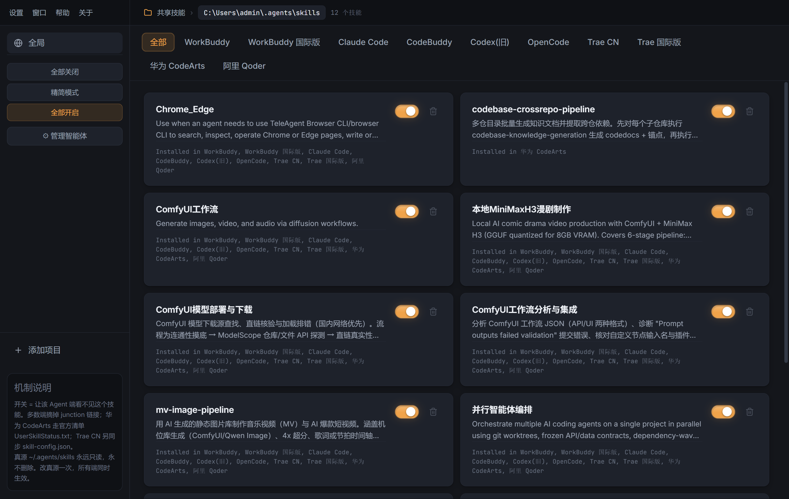

# Skillsmith —— 智能体技能管理软件

管理各家 AI 工具（WorkBuddy / Claude Code / Trae / CodeArts / Qoder …）共享的**技能真源**。

做两件事：

- **装** —— 从本地文件夹或 git 仓库安装技能。装之前给出文件清单、体积、上下文占用与安全扫描，
  让你先看清「装进来的是什么」。
- **开** —— 一次开关同时改目录**和**各客户端自己的账本（WorkBuddy 的 `skillOverrides`、
  Trae 的 `disabledSkills`、CodeArts 的 `UserSkillStatus.txt`），不用再去客户端里点一遍。

真源只有一个（默认 `~/.agents/skills`，地址可在设置里改），本工具**从不删除真源内容**。

> 本仓库是**独立的通用软件**，与任何具体技能无关 —— 技能的内容由各自的仓库维护，
> 本工具只负责把它们装进来、以及在各端开合。

> 英文名取自 smith（锻造者/工匠）—— 管理技能的匠人；中文副标题「智能体技能管理软件」。



---

## ⬇️ 下载

**[Releases](https://github.com/kuoleroy/skillsmith/releases)** 页面有打包好的 Windows 安装包（NSIS，双击即用，
不需要装 Node）。

> 安装包**未做代码签名**（没有证书），Windows SmartScreen 可能提示"未知发布者"，
> 点"更多信息 → 仍要运行"即可。

想自己构建：

```bash
cd electron
npm ci              # postinstall 会自动下载 Electron 运行时（~250MB）
npm run dist        # 产物：dist/Skillsmith-1.0.1-setup.exe
```

> Electron 37+ 不再自带 `postinstall`，运行时下载要自己触发。
> 本项目在 `package.json` 里补了 `postinstall` 调 `install.js`，
> 所以 `npm ci` / `npm install` 会自动完成，国内可设
> `ELECTRON_MIRROR=https://npmmirror.com/mirrors/electron/` 加速。
> 注意镜像地址末尾**不能带 `v`** —— 版本号自带的 `v` 前缀由 electron 自己拼。

版本记录见 [CHANGELOG.md](CHANGELOG.md)。

### 在另一台电脑上使用

装完就能用，无需 Node、无需联网、无需管理员权限。前提是 Windows 10/11 x64。

**第一步：把技能内容搬过去。** 安装包只带程序，不带技能数据。
新电脑上真源目录 `~/.agents/skills` 是空的，三种搬法：

| 方式 | 做法 |
|---|---|
| 手工拷贝 | 把旧机 `~/.agents/skills/*` 复制到新机同名目录 |
| 指向同步盘 | 设置 → 共享技能真源地址 → 填同步盘/移动硬盘路径 → 「重新绑定所有端」 |
| 指向内网共享 | 同上（目标必须是本地 NTFS 路径，不能是 UNC 网络路径） |

> 真源换成新地址后必须点一次**重新绑定**，否则各端的 junction 还指着旧路径。

**第二步：各端按需安装。** 目标端目录不存在时软件会自动创建，
但如果那台机器压根没装 Trae / Claude Code，对应端开不开都没有意义。

**注意事项：**

- 所有路径都基于 `os.homedir()`，换用户名、换机器自动适配，无任何硬编码。
- 配置写在 `~/.agents/skillsmith/`，与安装目录无关 —— 换机不会串配置。
- 各端的联接必须建在 **NTFS** 盘上（FAT32/exFAT 建不了）；真源本身可以放别处，
  但要是本地路径 —— junction 指向 UNC 网络路径会失败。
- 未做代码签名，SmartScreen 可能提示"未知发布者"。
- 想跨平台（macOS / Linux）需要另配构建目标，当前 CI 只出 Windows x64。

---

推 tag（`v*`）会让 GitHub Actions 自动构建并发布 Release：

```bash
git tag v1.0.1 && git push origin v1.0.1
```

---

---

## 两种形态

| | 浏览器版 | 桌面版 |
|---|---|---|
| 启动 | `启动浏览器版.bat` | `启动桌面版.bat` / 桌面快捷方式 |
| 界面 | 浅色（原上游风格） | 深色桌面主题 + 批量工具栏 + 智能体管理 |
| 端口 | 17888 | 随机端口（内嵌在进程里） |
| 前端 | 同一份 React（开源 skills-switch，MIT） | 同一份 + 主题层覆盖 |

两种形态**共用同一套后端逻辑**（`core.js` / `server.js` / `agent-config.js`），
不存在两套实现漂移的问题。

---

## 核心概念

### 真源（只读）

```
~/.agents/skills/<技能名>/     ← 唯一真源，永不删除、永不修改
```

各端目录里放的是**指向真源的目录联接（junction）**。
「关闭某个端上的某技能」= 摘掉那个端的联接；真源本身毫发无损。

### 各端的开关机制不同

**关键点：光摘目录不够。** 部分客户端除目录之外，还在自己的配置里另记一份
「哪些技能被关掉过」。只动目录时，客户端读完自己那份账本又会当作禁用 ——
表现就是「本工具里显示已开，客户端里还是关的，还得再去点一次」。

所以对这类端，开关必须**同时**改两处：

| 端 | 目录机制 | 客户端私有账本 |
|---|---|---|
| Claude Code、CodeBuddy、Codex、OpenCode、Qoder | `junction` | 无 —— 摘目录即完全生效 |
| WorkBuddy、WorkBuddy 国际版 | `junction` | `settings.json` 的 `skillOverrides`（开=删记录） |
| Trae CN、Trae 国际版 | `junction` | `skill-config.json` 的 `disabledSkills` 数组 |
| 华为 CodeArts | `realdir`（真实副本） | `skills/UserSkillStatus.txt`（`name=false`） |

CodeArts 是特例：它用 `readdir` 过滤掉符号链接，**只认真实目录副本**，
所以给它装技能必须复制实体目录，关闭则走官方清单。

WorkBuddy 的账本语义（读它自己的程序确认，不是猜的）：

```js
// 它的内部实现
toggleSkill: disable
  ? setSkillOverrides(key, fullyDisable ? 'off' : 'user-invocable-only')  // 关
  : deleteSkillOverrides(key)                                            // 开 = 删记录
```

`off` / `user-invocable-only` / `name-only` 三者都表示「模型不得自动调用」。
本工具写 `off`（完全关闭），因为它要表达的就是「关掉」，而不是「留着手动调」。

### 一致性自检

两处都改才叫真开，所以需要能验证。命令行：

```bash
node align-ledger.js            # 预演：列出目录与账本不一致的项
node align-ledger.js --apply    # 对齐（以目录状态为准，写盘前自动备份）
```

HTTP 接口：`GET /api/verify` 返回 `{ ok, checked, problems }`。

`problems` 里最常见的是 `dir-on-ledger-off`：目录已就位，但客户端账本
仍记着禁用 —— 这一条就是「开了还要去客户端再开一遍」的直接证据。

---

## 安装技能

Skillsmith 不只是开关面板，它也是技能的安装入口。三种来源：

```
本地文件夹      ./my-skill   或   C:\path\to\skill
简写仓库        owner/repo
仓库地址        https://github.com/owner/repo
指定子目录      owner/repo#skills/foo
完整路径        https://github.com/owner/repo/tree/main/skills/foo
```

### 装之前先看清楚

安装分两步，**中间必须过一道预览**：

1. **预览**（`POST /api/install/preview`）—— 把来源拉到临时目录，解析清单、
   跑安全扫描、算体积与上下文占用，返回完整报告。**只读，不写任何东西到真源。**
2. **安装**（`POST /api/install`）—— 会重新拉取一次并比对 commit，
   两次之间来源被换掉就中止。**预览里看到的就是装进去的。**

报告里有什么：

| 项 | 说明 |
|---|---|
| 名称 / 描述 / 版本 / 许可 / 作者 | 从 `SKILL.md` frontmatter 解析，缺什么标什么，不假装有 |
| 来源与 commit | git 来源记录到具体提交，以后能对上是哪一版 |
| 体积 | 文件数与字节数（不算 `.git`） |
| 上下文占用 | 按入口正文粗估的 token，装之前就知道它会吃掉多少 |
| 安全发现 | 分级列出，见下 |
| 冲突 | 真源里是否已有同名技能、之前装过什么版本 |

### 安全扫描：只报告，不拦截

一个技能 = **一段会被 AI 自动加载进上下文的 markdown** + **一堆会被自动执行的脚本**。
它同时踩中两类风险，所以扫描分两类看：

**代码风险**

| 级别 | 例子 |
|---|---|
| 高危 | `curl ... \| sh`、PowerShell 下载执行（IEX）、base64 解码后执行、读 SSH 私钥 / 云凭据 / 浏览器密码库、把本地文件上传出去、`rm -rf ~`、写计划任务与注册表自启动、写 `System32` |
| 留意 | 提权、`chmod 777`、动态 `eval`、导出环境变量挑密钥 |
| 提示 | 普通的网络请求（大多数技能都有，仅告知） |

**提示词风险（技能独有）**

`SKILL.md` 的内容会进 system prompt，所以还要查：`忽略之前的指令` 这类改写话术、
零宽字符藏字、HTML 注释里藏指令、技能里夹带 `.exe/.dll`。

**为什么不禁用而是让人看**

合法技能天天调 API —— `comfyui` 要发 HTTP、跑 python，`parallel-agents` 带 shell 脚本。
一刀切会把正常技能挡在门外，用户学到的只会是「关掉检查」。所以扫描器只把
**发现项 + 证据原文 + 一行原因**摆出来，判断权给人。

> 扫描规则是照真实误报调出来的。第一版把 `curl -fsS`（fail+silent）当成了 `-F`（表单上传），
> 把 `ENV_API_KEY` 常量当成了 `env` 命令，12 个真实技能报出 7 个假高危。
> 现在这两类都有回归测试钉着 —— 见 `test_safety.js` 第 6 节。

### 已装清单的三种状态

`GET /api/installed` 把**安装记录**和**真源实况**对起来看，因为两者会不一致：

| 状态 | 含义 | 怎么办 |
|---|---|---|
| `installed` | 记录与目录都在 | —— |
| `missing` | 有记录，目录没了（手删了，或从别的机器搬走） | `remove` 清掉残留记录 |
| `unmanaged` | 目录在，没记录（手工拷进来的） | `adopt` 纳管，之后才有来源与版本信息 |

`unmanaged` 这一种很实用：之前把技能直接拷进真源，软件完全看不见；现在至少能列出来并纳管。

### 元数据不写进技能目录

安装记录在 `~/.agents/skillsmith/installed.json`，**不在技能目录里**。

写进去会污染真源，而且客户端会把多出来的文件也读进上下文。技能目录必须保持
「可分发」的原样 —— 这也是为什么仓库到真源的同步脚本会清掉 `.github`、`.gitignore` 这类文件。

### 命令行

界面是主路径，CLI 用于脚本化和排障：

```bash
node skillsmith.js preview owner/repo      # 只看，不装
node skillsmith.js install owner/repo      # 装（会先预览再问一次）
node skillsmith.js list                    # 已装清单 + 三种状态
node skillsmith.js remove <name>           # 卸载：删真源 + 摘各端链接 + 清账本
node skillsmith.js adopt <name>            # 纳管手工放入的技能
```

---

## 桌面版功能

### 界面布局

```
┌────────────────────────────────────────────────────────────┐
│ [设置][窗口][帮助][关于] │ 📁 共享技能 › 路径 › 12 个技能 │  [原生窗口控件] │
├──────────────┬─────────────────────────────────────────────┤
│ 全局          │ [全部][WorkBuddy][Trae CN]…  ← Agent 标签栏  │
│ 全部关闭      │ ┌────────────┐ ┌────────────┐               │
│ 精简模式      │ │ 技能卡片    │ │ 技能卡片    │               │
│ 全部开启      │ └────────────┘ └────────────┘               │
│ ⚙ 管理智能体  │                                              │
│ + 添加项目    │                                              │
│ 机制说明      │                                              │
└──────────────┴─────────────────────────────────────────────┘
```

左上角是应用菜单栏（在侧边栏顶部原 logo 的位置），右侧是路径面包屑，
两者同在一条 44px 高度线上，构成统一的窗口标题栏。
右端留给系统原生的最小化/最大化/关闭按钮。

### 1. 菜单栏

| 菜单 | 内容 |
|---|---|
| **设置** | 共享技能真源地址… / 重新绑定所有端… / 智能体管理… / 恢复默认真源地址 |
| **窗口** | 最小化 / 最大化·还原 / 重新加载 / 开发者工具 / 关闭（带快捷键提示） |
| **帮助** | 使用说明（README）/ 打开配置目录 / 关于本应用 |
| **关于** | 版本 + Electron/Chromium/Node/平台/真源 信息表 + 许可说明 |

### 2. 批量操作（侧边栏）

- **全部关闭** —— 普通对话推荐，能显著减少 token 消耗
- **精简模式** —— 只保留 `comfyui`、`mv-image-pipeline`、`tencent-docs-cli`
- **全部开启**

### 3. 智能体管理（侧边栏「⚙ 管理智能体」）

可以**新增 / 重命名 / 删除**各个厂家的 AI 智能体端：

- 名称、路径可直接编辑，点 ✓ 保存
- ●/○ 切换启用停用（停用的端不显示、不参与批量操作）
- ＋ 新增智能体：填名称、目录、开关机制（junction / realdir）、可选状态文件
- ✕ 删除（内置端删了可以「恢复默认」撤销）
- **机制可改**：每行都有 junction / realdir 下拉，不确定就选 junction
- **⚙ 状态清单**：客户端装在非默认位置时，把状态清单路径、格式
  （json 数组 / key=value 行）、字段名一起改掉；留空 = 只靠目录联接开关

**客户端没装也能先配**：填好目录后开关会自动创建该目录，客户端装好后直接生效；
路径不对就改路径框，客户端不在了就停用或删掉这一行。

#### 不支持接入的客户端：TeleAgent

它的技能开关**不是**「目录里有/没有」决定的：

```
~/.config/TeleAgent/users/<uid>/skills/          ← 技能目录
~/.config/TeleAgent/users/<uid>/TeleAgent.jsonc   ← 真正管开关的地方（permission.skill 白名单）
    └── .disabled.json / .usage.json              ← 状态与用量
```

摘掉目录链接它照样认（`.usage.json` 里还有记录），写 `.disabled.json` 又会被它自己的
云端同步覆盖；它的权限条目还带 `serverId` / `versionId` 的版本管理，外来工具插一脚
只会和它的同步逻辑打架。

所以本工具**不接、也不让误接**：

- 保存端时若路径命中 TeleAgent，直接拒绝并说明原因
- 即便有人手工改 `agents.json` 塞进 TeleAgent 路径，它也不会进生效映射 ——
  开关 / 批量 / 重新绑定一律不碰它
- 面板上会标「不支持」

要开关 TeleAgent 的技能，去它自己的面板里点。

配置持久化在：

```
~/.agents/skillsmith/agents.json
```

内置端在 `agent-config.js` 的 `BUILTIN_AGENTS` 里，用户配置按 `id` 覆盖，
新 `id` 追加，`remove: true` 删除内置端。

### 4. 共享技能真源地址（设置 → 共享技能真源地址）

真源（所有技能的唯一副本所在处）的地址可以改。配置在：

```
~/.agents/skillsmith/settings.json
```

**改完地址必须点「重新绑定所有端」** —— 各 AI 工具目录里的链接仍然指着旧地址，
不重新绑定的话改设置等于只改了一半。「预演」可以先看会改哪些（只报告不执行）。

### 5. 系统托盘

关闭按钮会最小化到托盘（不是退出）。托盘右键菜单：

- 打开面板
- 全部关闭 / 精简模式 / 全部开启
- 退出

### 6. 窗口拖动

无边框窗口没有系统标题栏，拖拽区是自己划的：

- 侧边栏顶部菜单条（空白处）
- 路径面包屑
- Agent 标签栏

菜单按钮、路径、开关等交互元素都是 `no-drag`，不会误触发拖动。

---

## 目录结构

```
skillsmith/            ← 仓库根就是软件本体
├── core.js              核心逻辑：junction 判定、增删、真源保护、重新绑定、一致性自检
├── client-state.js      客户端账本适配层：各端私有禁用记录的读写（三种格式）
├── manifest.js          技能清单容错解析：frontmatter 子集、名字校验、多技能仓库定位
├── safety.js            安全扫描：代码风险 + 提示词注入，分级只报告不拦截
├── installer.js         安装/卸载：来源解析、预览、落盘、来源记录、纳管
├── agent-config.js      智能体配置：内置基线 + 用户增删改合并
├── settings.js          全局设置：共享技能真源地址
├── server.js            HTTP 服务与 API（浏览器版与桌面版共用）
├── skillsmith.js        命令行入口：preview / install / list / remove / adopt
├── launcher.js          浏览器版启动器（剥掉 WorkBuddy 的 FS 护栏）
├── align-ledger.js      账本对齐工具（目录为准确认客户端账本）
├── verify-real-sync.js  真实环境联通性验证（开关一轮并断言两层同步）
├── 启动浏览器版.bat      浏览器版启动
├── vendor/              前端（复用开源 skills-switch，MIT）
│   ├── index.html
│   ├── theme.css        深色主题层（覆盖上游语义类）
│   ├── desktop-enhance.js  批量工具栏注入
│   ├── agent-manager.js    智能体管理面板
│   ├── settings-panel.js   路径面包屑 + 设置面板
│   ├── app-menu.js         应用菜单栏（设置/窗口/帮助/关于）
│   └── fonts/           离线字体（不依赖 CDN）
├── assets/              应用图标
├── electron/            桌面版
│   ├── main.js          Electron 主进程：窗口、托盘、单实例、IPC
│   ├── preload.js       最小 API 面
│   ├── stage.js         打包前把依赖平铺到 app/
│   └── 启动桌面版.bat
└── test_*.js            测试（共 179 项）
```

测试分布：

| 文件 | 项数 | 覆盖 |
|---|---|---|
| `test_installer.js` | 62 | 来源解析、预览、安装、覆盖、卸载、纳管、三种状态 |
| `test_agent_config.js` | 40 | 智能体增删改、账本字段保全 |
| `test_client_state.js` | 32 | 三种账本格式读写、损坏文件拒写、备份 |
| `test_safety.js` | 31 | 恶意样本命中 + 真实误报回归 |
| `test_rebind_broken.js` | 14 | 真源搬家后断链重绑 |

---

## 打包成 exe

```bash
cd electron
npm run dist        # 产物：dist/Skillsmith-1.0.1-setup.exe
```

用 NSIS 打包，安装后自带桌面快捷方式，不需要 Node 环境。

---

## 安全设计

**真源永远不动。** 所有「删除」操作都先经 `removeJunction()` 校验
「确实是 junction」，只摘链接。CodeArts 的实体副本若要真删，走
「先改名再删」两段式，避开宿主的递归删除护栏。

**写客户端账本时（`client-state.js`）。** 这些是用户真实使用的配置文件，
所以定了四条硬规则：

1. 文件不存在 → 当空账本，不报错
2. 文件存在但 JSON 解析失败 → **拒绝写入**并抛错。宁可这次开关失败，
   也不覆盖掉可能是手写的那份配置（WorkBuddy 自己也是这个策略）
3. 写盘前备份到 `~/.agents/skillsmith/backups/`（最多留 20 份）
4. 先写临时文件再 `rename`，内容没实际变化不写盘
   —— 客户端可能监听文件变化重扫，无谓写入会触发它整轮重扫

**WorkBuddy 的 FS 护栏。** WorkBuddy 会给子进程注入 `node-language-shim.cjs`，
统计删除次数，超阈值就拒绝后续删除。而「关闭技能」在 junction 端就是摘链接，
语义上被当成删除 —— 开关点多了会全部失效。启动器清空 `NODE_OPTIONS` 与
`CODEBUDDY_SESSION_ID` 重新 spawn 一个干净进程来绕开（护栏在没有会话 ID 时
不加载）。

**Electron 的环境变量。** WorkBuddy 注入的 `ELECTRON_RUN_AS_NODE=1` 会让
Electron 降级成纯 Node（`app` / `BrowserWindow` 全部 undefined），启动器必须清掉。

---

## API

```
GET  /api/agents?scope=global      上游契约：各端及其技能开关状态
POST /api/skills/:name/toggle      上游契约：切换单个技能
DELETE /api/skills/:name            上游契约：从各端摘除（真源保留）
GET  /api/projects                 上游契约
POST /api/projects                 上游契约

GET  /api/state                    扩展：完整矩阵 + token 估算 + 日志
POST /api/bulk                     扩展：{ action: on|off|lean }
GET  /api/verify                   扩展：账本一致性自检（目录 vs 客户端账本）
GET  /api/health                   扩展：健康检查
GET  /api/agent-config             扩展：列出全部端（含未安装/自定义）
POST /api/agent-config             扩展：{ action: save|remove|reset, agent: {...} }
GET  /api/settings                 扩展：读取设置（真源地址等）
POST /api/settings                 扩展：{ action: set-canon-root|rebind, ... }

GET  /api/installed                安装：已装清单（记录 ∪ 真源实况）
POST /api/install/preview          安装：{ source, subdir? }       只读，不写盘
POST /api/install                  安装：{ source, subdir?, overwrite?, expectedCommit?, enableAgents? }
POST /api/uninstall                安装：{ name }
POST /api/adopt                    安装：{ name }  把手工放入的技能纳入管理
```

`POST /api/install` 的 `enableAgents` 三种取值：

| 值 | 行为 |
|---|---|
| 不传 | 给所有归属该技能的端建立链接（默认，符合「装上就能用」） |
| `false` | 只放进真源，不动任何端 |
| `["WorkBuddy", …]` | 只给指定的端建立链接 |

安装类接口只监听 `127.0.0.1` 且只解析 JSON —— 跨站表单提交会在解析阶段被拒，
第三方网页无法诱导本机安装技能。

---

## 上游与许可

前端复用开源项目 [whale2002/skills-switch](https://github.com/whale2002/skills-switch)（MIT），
见 `vendor/LICENSE-skills-switch`。业务逻辑（junction 判定、各端机制适配、
智能体配置）为本机自有实现，替换了上游不适用的后端。
